<div align="center">


### Engage Link Identified Experience

**Visitor management and access control for Singapore condominiums.**<br/>
One platform for the guardhouse, the management office, the lobby kiosk and every resident's phone.


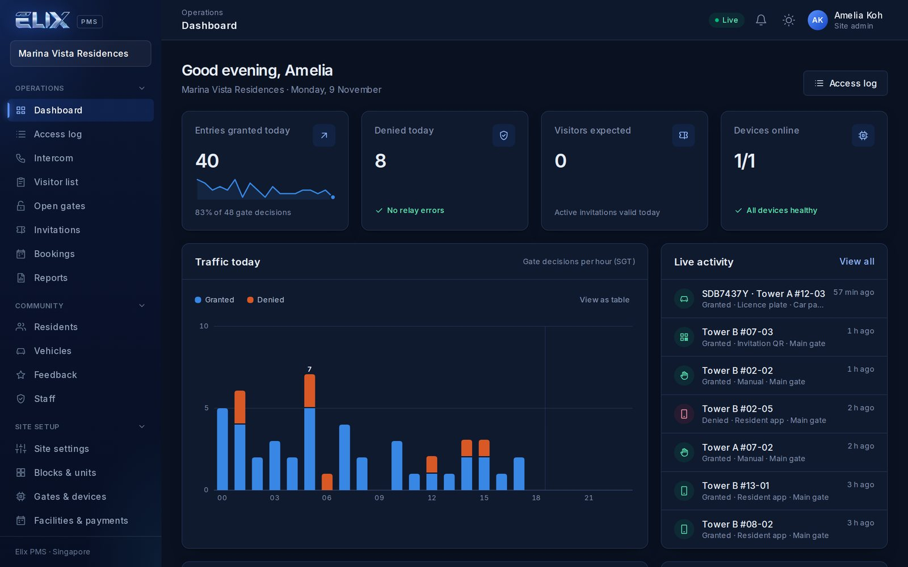

</div>

## What it does

- **Gates that know who's coming**: licence-plate recognition, QR invitations, video intercom with
  swipe-to-open, and remote opening from the resident app.
- **A friendly lobby kiosk** in English, 中文, Melayu and தமிழ்: visitors call a unit or the guardhouse,
  register as a walk-in with a printed pass, scan an invitation, check in to a facility booking (or come as a booking's guest), or check out, and can simply *ask*
  the AI concierge for directions or help.
- **A resident app**: open the gate, answer visitors, invite guests, book facilities, register
  vehicles, see notifications and the condo's documents.
- **A dashboard for the site team**: who is on site now, arrivals vs yesterday, overstay alerts per
  visitor type, vehicle passes (resident, season parking bought in the app, temporary) with start and end dates, live activity, visitor list, bookings and payments, feedback,
  reports, and role-based access for site admins, staff and officers.
- **Accessible**: designed to WCAG 2.1 AA (0 axe-core findings on the dashboard and landing page),
  with a Larger text option for staff and a "more time?" prompt on the kiosk.
- **A product page**: the site root is a landing page (features, an interactive 3D walkthrough of each
  journey, plans, PDPA, technology and security); the dashboard lives at `/dashboard/`.
- **Built for Singapore**: PDPA-minded data retention, NEA weather, HitPay payments, multi-site.

## How it works

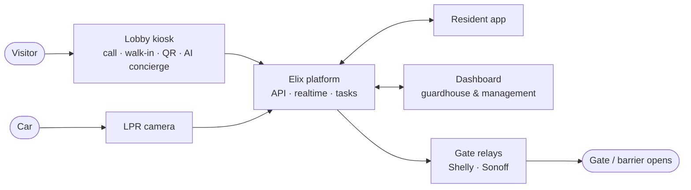

1. A visitor arrives at the kiosk, or a car reaches the barrier.
2. Elix checks the invitation, plate or pass, or rings the resident on their phone.
3. The resident or guard approves, and the gate relay opens.
4. Everything appears live on the dashboard and in the resident's activity feed.

## Screenshots

| Sign-in | Visitor list |
|---|---|
| 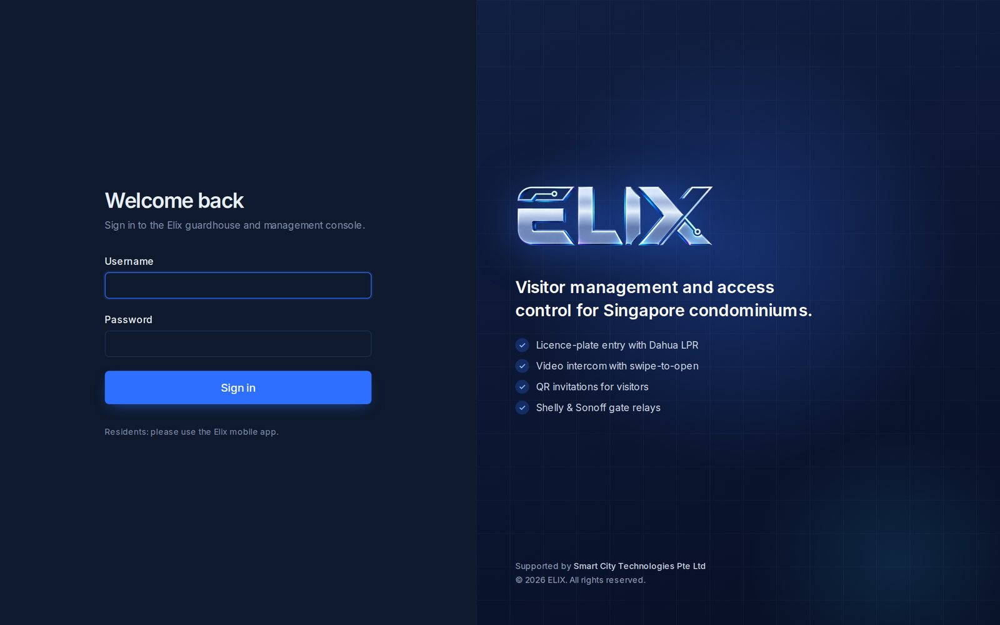 | 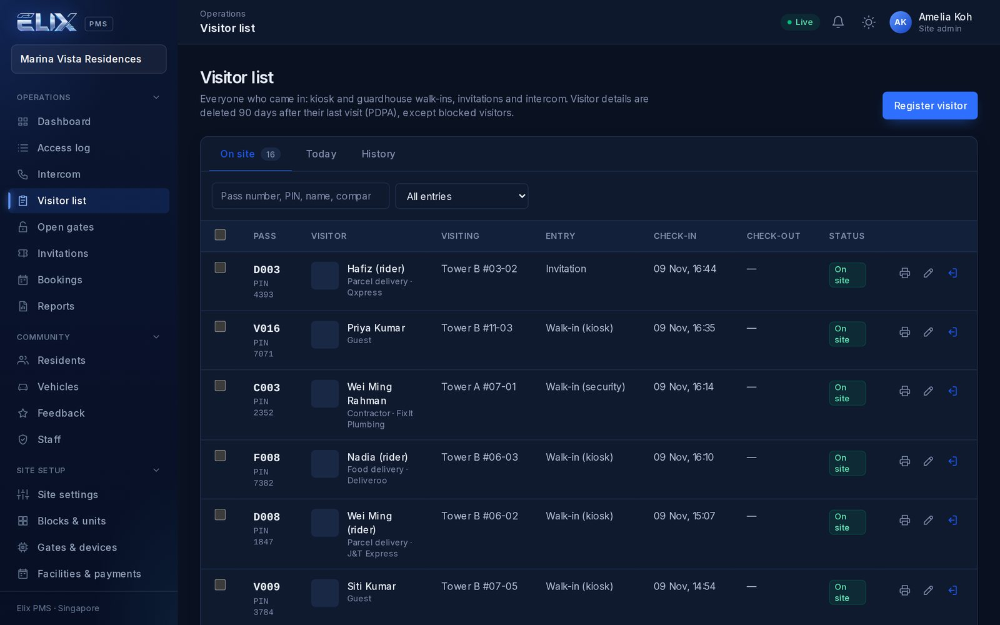 |
| **Lobby kiosk** | **AI assistant setup** |
| 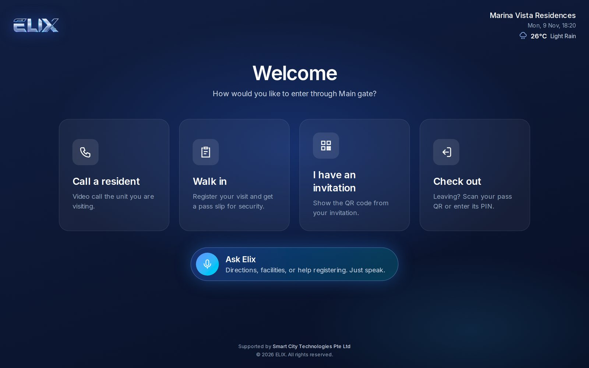 | 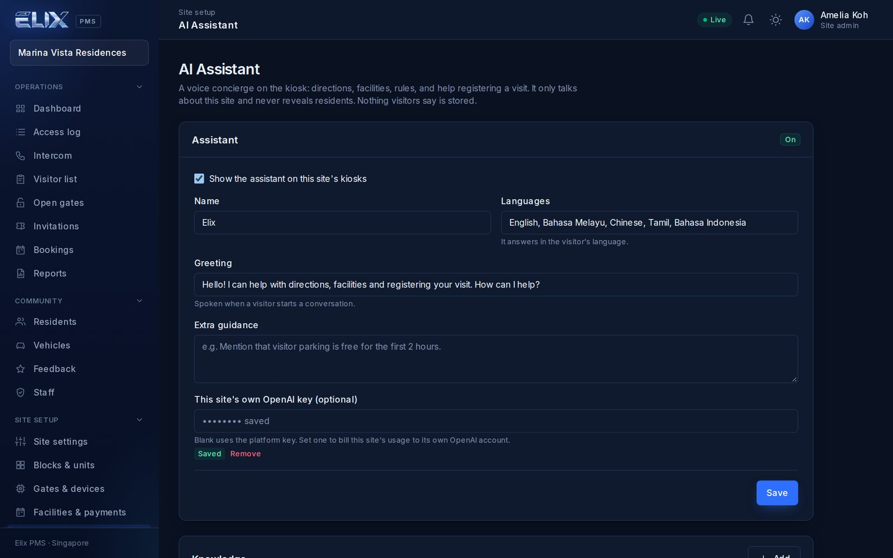 |

### Resident app

<p align="center">
  
  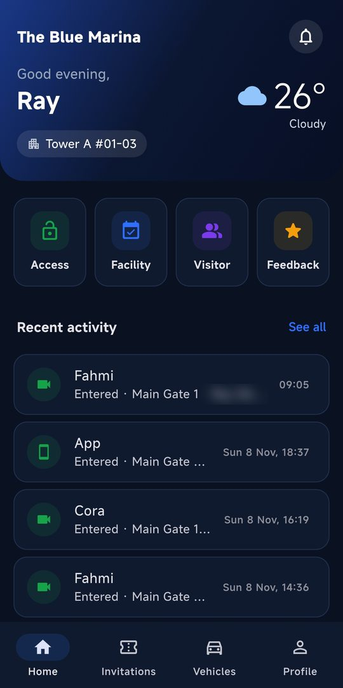
  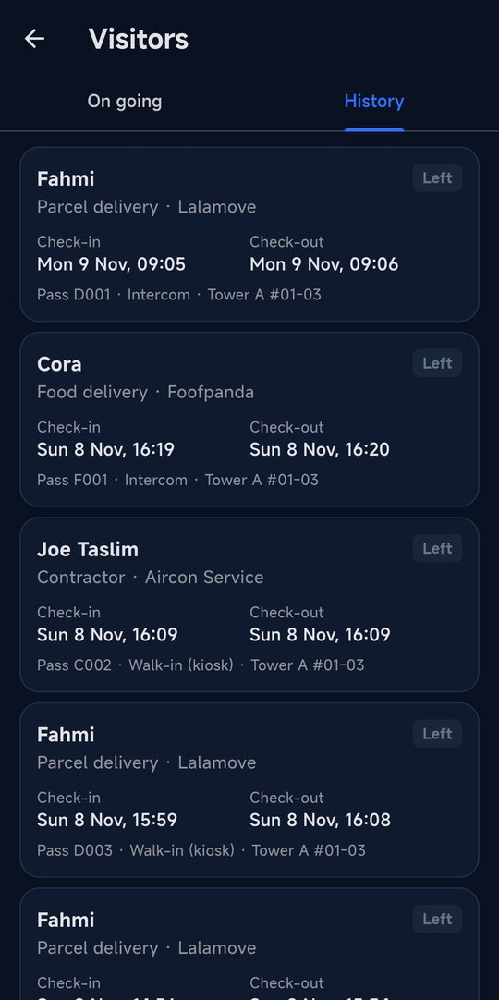
  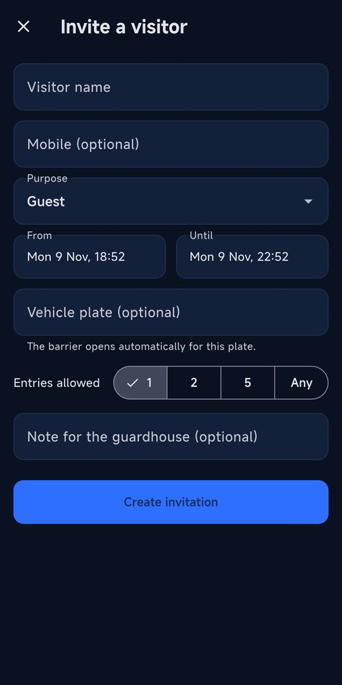
</p>
<p align="center">
  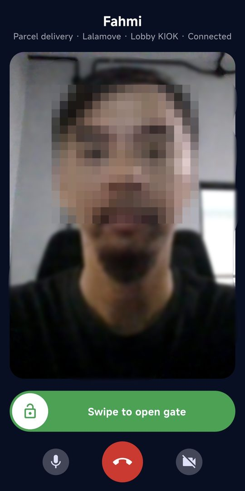
  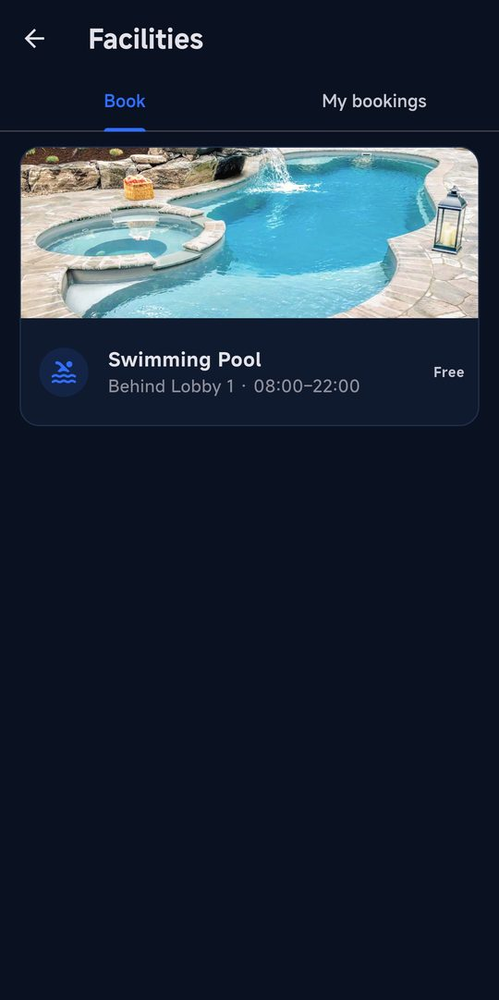
  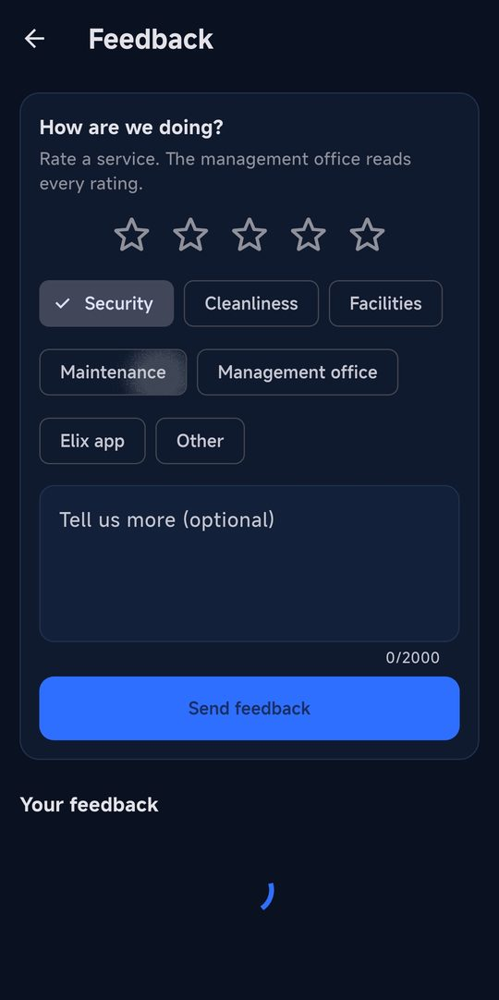
  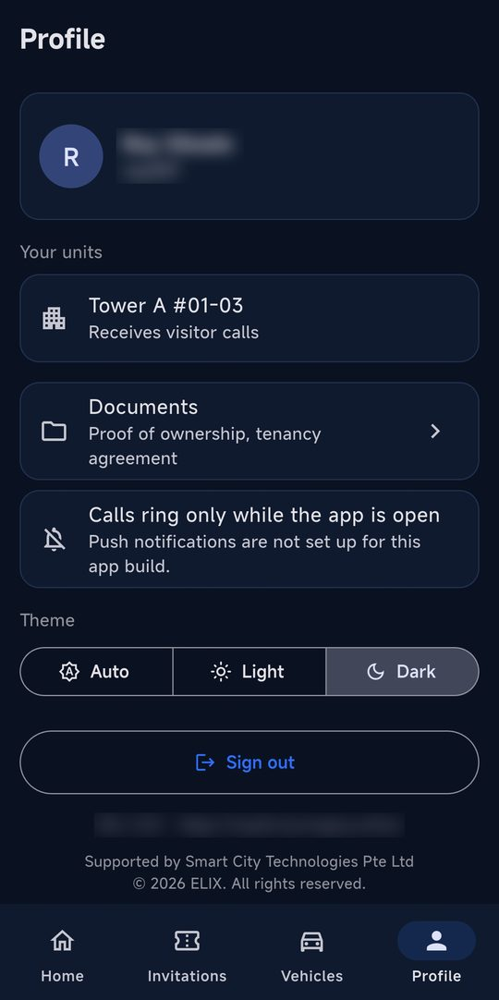
</p>

<sub>Screenshots use demo data; personal details are blurred.</sub>

## Tech stack

| Part | Technology |
|---|---|
| Backend & API | Python, Django, Django REST Framework, Channels (WebSockets), Celery |
| Dashboard & kiosk | Next.js, TypeScript, Tailwind CSS |
| Resident app | Flutter (Android), Firebase push |
| Data | PostgreSQL, Redis |
| Integrations | LiveKit video, Dahua LPR, Shelly & Sonoff relays, HitPay, OpenAI, NEA (data.gov.sg) |
| Infrastructure | Docker Compose, Nginx, Uvicorn, Cloudflare Tunnel, GitHub Actions (APK builds) |

## Getting started

```bash
cp .env.example .env
docker compose up -d --build
docker compose exec web python manage.py createsuperuser
```

Then open the dashboard and add your first condominium. Setup, production deployment and every
integration are covered in the guides:

- 📘 [Technical guide](docs/TECHNICAL.md): features, API, integrations, production
- 🇮🇩 [Panduan (Bahasa Indonesia)](docs/PANDUAN.md)

## Repository

```
backend/    Django API, realtime and background tasks
frontend/   Next.js dashboard and lobby kiosk (served by Nginx)
mobile/     Flutter resident app
docs/       Guides and screenshots
scripts/    Deployment helpers
```

---

<div align="center"><sub>© 2026 ELIX. All rights reserved.</sub></div>
